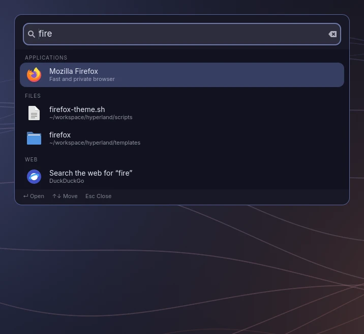
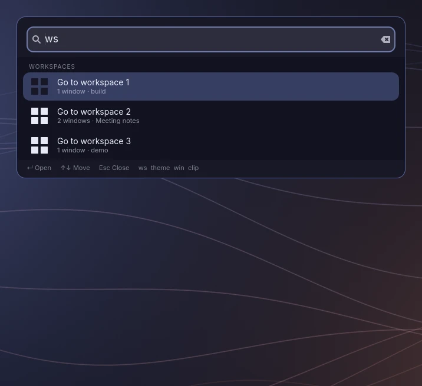
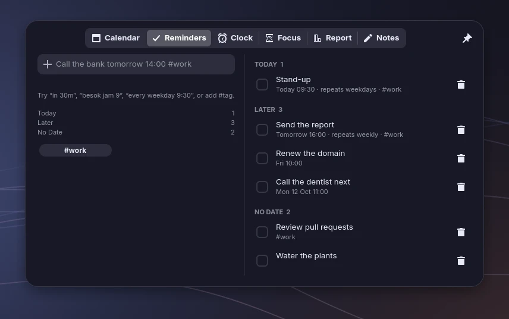
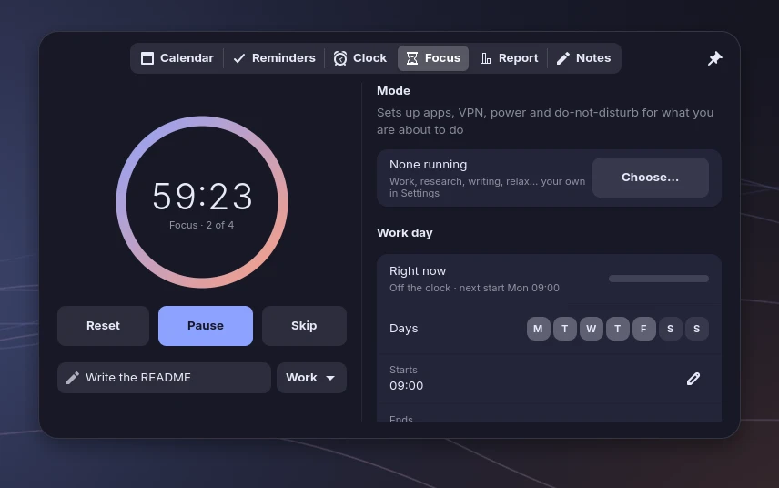
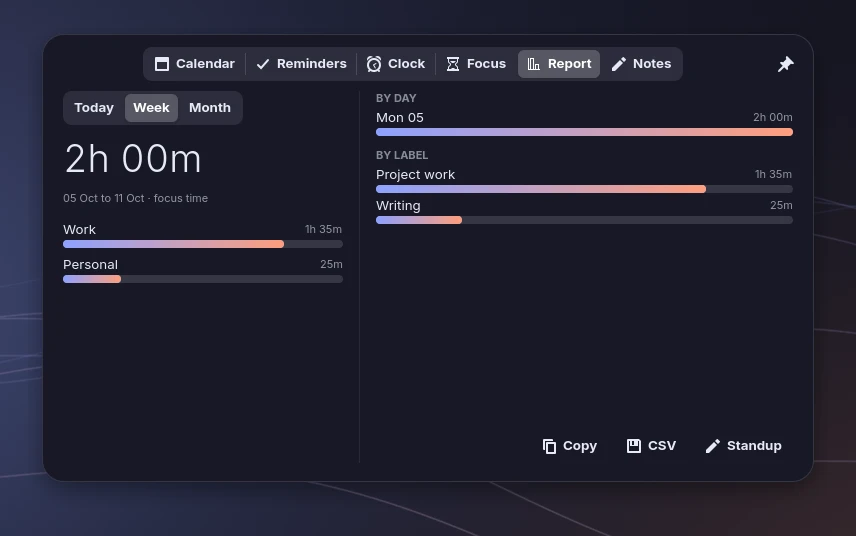
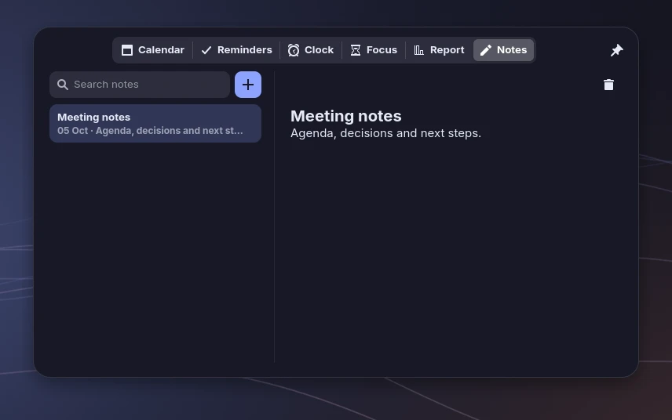
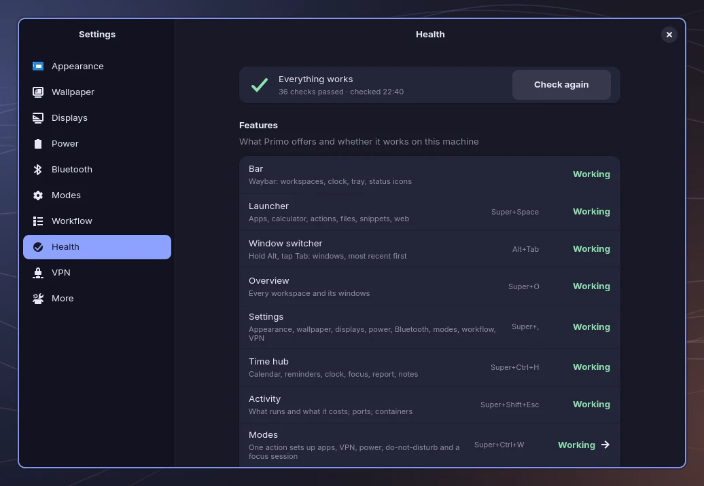

# The tools that come with Primo

Everything here is written for this setup and styled by the active theme. Most of it is Python with GTK 4 and libadwaita, and the
windows that open often (launcher, switcher, overview, time hub, activity) run as small background services so they appear instantly.

## Settings (`SUPER+,`)

A libadwaita app with these pages. Pages open at once and fill in as the system answers; a change you make (applying a theme, a
display layout, a power mode, a Bluetooth or VPN switch) runs in the background, one at a time per item, and the page shows what the
system reports afterwards. If a tool is slow you see "it is taking too long" and the real state, not a success you were not given.

- **Appearance**: dark and light switch, and theme cards with a live palette preview. Two switches, **Reduce interface motion** and
  **Reduce interface transparency**, apply to Settings and the launcher only: the page change in Settings stays still, and selections and cards
  are solid colours. Settings changes at once; the launcher uses your choice the next time it opens. They do not touch Hyprland's window and
  workspace animations, the bar, notifications or other applications, and if animation is already off in your system settings it stays off
  whatever you choose. The choice is kept in `~/.config/primo/ui.json`, which a theme change never rewrites; if it cannot be saved, the
  switch goes back and says why.
- **Wallpaper**: a gallery of theme art and `~/Pictures` (previews appear as they are ready; a picture too big or broken to preview still
  has its tile, and its tooltip says why). A picture you choose survives theme switches until you press "Use the theme's
  wallpaper". Also a slideshow from a folder (every minute to every three hours), animated transitions when `awww` is installed, GIFs
  (through `awww`), videos (through `mpvpaper`, paused on battery with a notification). Lock and login screens: the desktop
  wallpaper, blurred windows (lock only) or a picture, GIF or video of their own. When a GIF or video cannot play, its still
  frame is shown instead of the theme's wallpaper; `~/.local/state/hyprland-dotfiles/wallpaper.log` says why.
- **Notification panel**: its quick buttons are generated at start-up from what is installed (the base `config/swaync/config.json` is never
  rewritten; the copy lives in `~/.cache/primo/swaync/`). The network and sound buttons open the Network and Audio pages here, a button whose
  tool is missing is not shown, and if the copy cannot be made the last good one is used, or swaync's own defaults (notifications only).
  Opening the panel refreshes it, so installing a tool shows its button without a restart.
- **Audio** (needs `pactl`): the output and input device (the system default), volume and mute for each, refreshed every two seconds while the
  page is open. A device is chosen by its name, so two with the same label stay apart, and one that was unplugged meanwhile is refused with
  a message, not replaced by another. Choosing a device sets the system default; a program that is already playing may keep its old one.
  A level above 100 % is shown as it is and left alone until you move it. `--page audio` opens it; "More audio settings" opens `pavucontrol` when it is installed.
- **Network** (needs `nmcli`): the Wi-Fi networks your card heard, with signal and security, a search box, and your saved Wi-Fi and wired
  connections (VPNs have their own page). A network is told apart by its card and hardware address, not its name, so two with the same name
  stay two rows. The list refreshes every five seconds without scanning; **Refresh** scans. If nothing is running that can ask for a
  Wi-Fi password (`nm-applet`), the page says so; saved networks still work. Click a network to connect (a password is asked by `nm-applet`, never by Primo; company or school sign-in networks offer the
  advanced editor), **Disconnect** and the Wi-Fi switch ask first, and the list shows what NetworkManager did, not what was requested.
- **Displays**: resolution, refresh rate, scale, rotation and arrangement for each monitor. Changes apply live and revert by themselves
  after 10 seconds unless you press Keep. Kept settings are saved to `~/.config/hypr/displays.lua` (git-ignored). It replaces
  `nwg-displays`, which writes hyprlang files the Lua config does not read.
- **Power**: Power Saver, Balanced or Performance, charge, time left, battery health, and the low-battery behaviour.
  Idle times for dimming, locking, turning off the screen and sleep each include **Never**. Press **Apply** to save them in
  `$XDG_CONFIG_HOME/hypr/primo-idle.conf` (normally `~/.config/hypr/primo-idle.conf`) and restart Primo's idle service.
  Until you save, the defaults are 2 min 30 sec, 5 min, 5 min 30 sec and 30 min. Manual lock and suspend, and critical-battery
  suspend, still work with Never. If an older session started hypridle directly, log out and back in after saving.
- **Bluetooth**: paired devices with Connect, Disconnect and Forget.
- **Health**: every feature and whether it works on this machine, plus the checks behind it (see "Health and the `primo` command" below).
- **Modes**, **Workflow**, **VPN**: described below.
- **More**: shortcuts to Sound, Network, Notifications, Timeshift, Baobab and KeePassXC (only the ones that are installed).

## Launcher (`SUPER+Space`)



One search box for everything: applications ranked by how often you open them, a calculator (`12*(3+4)`, `sqrt(16)`, `15% of 80`; Enter
copies the result), system actions (lock, sleep, dark and light, night light, settings pages, modes, calendar, reminders, notes),
your snippets, open windows, files under your home folder (five levels deep; hidden folders and `node_modules` are skipped), and a
web search fallback.

Type a command word and a space to ask one source only:

| Type | Result |
| --- | --- |
| `ws 4` | Go to workspace 4. `ws` alone lists the workspaces with what is on them. |
| `theme dusk` | Switch theme. `theme` alone lists them. |
| `win firefox` | Find an open window and focus it. Windows also show up in a plain search. |
| `clip token` | Search the clipboard history; Enter copies the entry again. |
| `audio `, `network `, `vpn ` | Open that Settings page. `audio` also offers the sound mixer and microphone mute, `network` the advanced connection editor. |
| `display `, `power `, `doctor ` (or `health `) | Open the Displays, Power or Health page. `display` also has night light; `power` the session menu and log out. |
| `capture ` | Screenshot an area or the whole screen, annotate it, or start and stop a recording. |

The last three rows need the word and a space (`audio `), and a word after it narrows the list (`capture record`). Each entry is hidden when its
tool is missing (the same list Settings > Health shows); if nothing is left, one line says what is missing. "Open …" opens a page or program;
"Mute", "Toggle" and "Record" change something when you press Enter. Typing never changes anything, and restart and shut down stay behind the
session menu's confirmation.



The clipboard history can hold passwords, so it is never mixed into a plain search: it only appears after `clip`, `clipboard` or `cb`.

An action whose tool is not installed (night light without `hyprsunset`, the colour picker without `hyprpicker`, screenshots without `grim`) is not listed until the tool is installed.

## Overview (`SUPER+O`)

Every workspace as a card with its windows. With two monitors the cards are grouped under each monitor's name (a monitor that was unplugged
keeps its group, marked "not connected", until its workspaces are gone), and the list scrolls when it is long. Workspace names are the
ones Hyprland has. It opens at once with the last view it had and refreshes by itself every 2 seconds while it is open; if Hyprland does
not answer it keeps what it showed and says so.

Type to search by window title, app or workspace name (capital letters and accents do not matter); the arrows pick a result and Enter
focuses it. Digits you type are part of the search, so jump to a workspace with `Alt+1`–`9`. "Close after choosing" is on by default; turn it
off to keep the overview open after you pick a window (Esc, or clicking outside it, still closes it). The choice is saved in
`~/.config/primo/overview.json`.

## Time hub (click the clock, or `SUPER+CTRL+H`)

A floating panel under the bar clock. It does not push your windows around and it closes when you click elsewhere; the pin keeps it open
and shows it on every workspace.

- **Calendar**: a month, the plans of the day you pick, and meetings from calendar links (see Workflow).
- **Reminders**: type them in plain words, in English or Indonesian: `call the bank tomorrow 14:00 #work`, `besok jam 9 rapat`,
  `in 30m`, `standup every weekday 9:30`. Reminders repeat, can be snoozed from the notification, and are grouped as overdue, today, later.
- **Clock**: world clocks, alarms, a stopwatch with laps, and timers that keep running with the window closed.
- **Focus**: a Pomodoro with what you are working on, work hours with an end-of-day warning and break reminders, do-not-disturb while
  you focus, and your VPN switches.
- **Report**: where your focus time went (today, week, month, by category, day and label), as CSV or a Markdown summary, and a daily
  standup note built from what you finished and what is due.
- **Notes**: plain Markdown files in `~/Notes`, saved as you type, with a list beside the editor.

<table>
  <tr>
    <td width="50%"></td>
    <td width="50%"></td>
  </tr>
  <tr>
    <td width="50%"></td>
    <td width="50%"></td>
  </tr>
</table>

A background service keeps timers, alarms and reminders running while the window is closed. Its data is
`~/.local/share/primo/hub.json` (`$XDG_DATA_HOME`). Before 0.3.0 it was in `~/.local/state/hyprland-dotfiles/hub/`; the hub moves it
the first time it starts and keeps the old file next to it as `hub.json.bak-primo`.

## Modes (`SUPER+CTRL+W`)

A mode is a recipe for what you are about to do: which apps open on which workspace, a VPN, a power mode, do-not-disturb and a focus
session. Ending it puts power, do-not-disturb and the VPN back (apps stay open). Work, Research, Writing and Relax are there to start
from; make your own in Settings > Modes. A mode can ask for a project folder and pass it to its apps as `{dir}`.

## Activity (`SUPER+SHIFT+Esc`, or the pulse icon in the bar)

What is running and what it costs: apps and background programs with CPU, memory, GPU, disk and connections, grouped by process tree
(a command-line tool and its helper servers show up together; which tools is set in `~/.config/primo/activity.json`). Badges appear only when something really uses the microphone, camera or screen share.
Quit, force quit or freeze with a confirmation; the session itself is protected. Tabs for services and timers, and a **Dev** tab: who
holds a port, build tools and runtimes with their folder, and Docker containers (needs your user in the `docker` group). Type to search.

## Workflow (Settings > Workflow)

- **Calendars**: paste a secret `.ics` link (Google Calendar, Outlook…). Read only. Meetings appear in the Calendar and remind you before they start.
- **Apps on workspaces**: an app always opens on the workspace you choose.
- **Snippets**: text you reuse. Type its name in the launcher and it is copied.
- **Notes backup**: an automatic local history of `~/Notes` (a git repository), pushed only if you add a remote and turn that on.
- A pull-request indicator in the bar shows reviews waiting for you (needs `gh auth login`).

## Health and the `primo` command

Settings > Health lists every feature (bar, launcher, notifications, lock screen, VPN, …) as working, stopped or unavailable, with the
reason and the command that fixes it, and the checks behind them: the session, resident services, packages, configuration, theme and
system.



From a terminal:

```bash
primo status                 # version, theme, mode, services, health, on one screen
primo doctor                 # every check; problems first (-v lists the passing ones, --category services)
primo features               # what Primo offers and whether each feature works here
primo config path            # the folders and settings files Primo reads
primo config show            # the settings in effect and where each comes from (links and snippet texts hidden)
primo config validate        # check every settings file; names the file and line of a problem
primo doctor --json | jq '.checks[] | select(.status != "pass")'
primo snapshot --dry-run     # what a copy of your Primo settings would hold, and what it leaves out
primo snapshot               # take it: ~/.local/share/primo/snapshots/<id>, private (0700/0600)
primo snapshot list          # also: show ID, remove ID
```

If you turned on Primo's systemd user units (`scripts/install.sh --services`, see `docs/ARCHITECTURE.md`), the Services checks also say how each
unit is doing: running, starting, stopped, failed, or simply disabled or not installed, which is normal and never a fault. `primo features --json` carries
the same word as `supervisor`. A unit in trouble shows as a warning and a note on its feature; a core service still counts as working or stopped by its
own process check.

A snapshot copies only the settings Primo itself owns (modes, activity, overview and interface settings, the time hub's reminders and timers, a few
state files such as the current theme and wallpaper), never your whole home folder and never generated files. Files that can hold secrets, the
calendar links and snippets in `workflow.json` and the launcher history, are left out unless you add `--include-sensitive`. A file bigger than 1 MiB is
left out and named. Nothing is deleted for you: past 10 snapshots it tells you to remove old ones, past 25 it refuses. Restoring is a separate step
(see below when it is available); a snapshot taken while a file kept changing says it is incomplete and cannot be restored.

Apart from `primo snapshot`, which writes only inside its own folder, nothing here changes the system, `primo config` included: a fix is only ever printed as a command for you to run. Exit codes: 0 healthy, 1 warnings, 2 at least one
failure, 64 usage error. Colours are off when `NO_COLOR` is set or the output is not a terminal. `scripts/install.sh` links `primo` into
`~/.local/bin`.

## Laptop

- **Power mode** (`power-profiles-daemon`): an icon in the bar cycles Power Saver, Balanced and Performance.
- **Battery watch** warns at 20% (and switches to Power Saver until you plug in), at 10%, and suspends at 4%.
- **Bluetooth** (`bluez`, `blueman`): a bar icon with the number of connected devices.
- **VPN** (NetworkManager): Settings > VPN lists your connections with a switch each, imports `.ovpn` files, and a shield appears in the
  bar while one is connected.
- **System setup**: `sudo scripts/setup-system.sh` shows the plan; `--apply` enables Bluetooth, power profiles, fast mirrors (`reflector`),
  `paccache` and a `ufw` firewall that denies incoming connections. Each edited file is backed up.

## Notifications

`swaync` gives a control center (click the bell in the bar): history, do-not-disturb, quick toggles, volume and brightness sliders and media
controls. Right-click the bell for do-not-disturb. Without swaync, dunst is used and the bell only toggles do-not-disturb.

## Files, screenshots, recordings

- **Nautilus** opens as a floating, Finder-style window on `SUPER+E`: select a file and press Space for Quick Look (`sushi`), expand folders
  in place in list view, drag to the sidebar favourites. Images and PDFs open in Loupe and Papers. `SUPER+SHIFT+E` opens Dolphin for split
  view and bulk rename. `scripts/configure-apps.sh` applies the view settings and default apps.
- **Screenshots** land in `~/Pictures/Screenshots` and on the clipboard; the notification offers Annotate (satty, with the theme's palette)
  and Show in folder.
- **Recordings** (`wf-recorder`) land in `~/Videos/Recordings`; a red timer appears in the bar and clicking it stops the recording.

## Workspaces, layouts, window rules

Each workspace has a purpose and a layout: 1 general (dwindle), 2 code (master), 3 reading and media (scrolling), 4 focus (monocle).
`SUPER+TAB`, or a click on the bar icon, cycles the layout of the current workspace. Edit the presets in `config/hypr/modules/workspaces.lua`.

Small utility apps float centred instead of tiling: pavucontrol, nm-connection-editor, blueman, Timeshift, polkit prompts and file pickers.
Firefox Picture-in-Picture floats pinned in the bottom-right corner, and fullscreen windows inhibit idle and lock. Add more in
`config/hypr/modules/rules.lua`; find a window's class with `hyprctl clients`.

## Good to know

- Clipboard history (`cliphist`) stores everything you copy, including passwords from a password manager. Wipe it with `cliphist wipe`, or
  remove the `wl-paste … cliphist store` lines in `config/hypr/modules/autostart.lua` to turn it off.
- Validate the Hyprland config with `Hyprland --verify-config -c config/hypr/hyprland.lua`.
